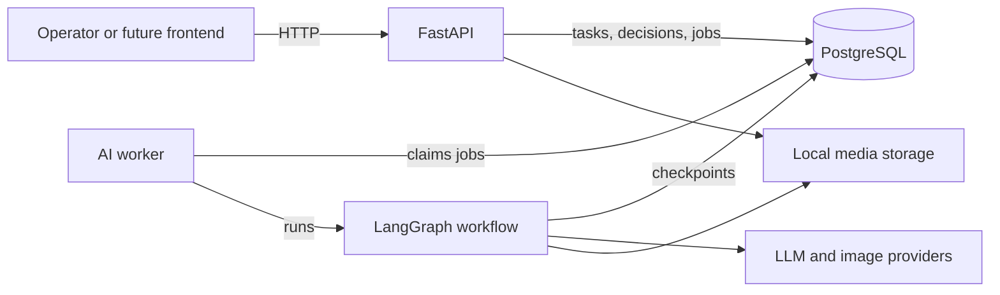

# PetMedia AI

Backend for AI-assisted social media content production for a pet products company. An operator picks products, then AI proposes topics, writes a draft, adapts it for Instagram and Facebook, and produces a 3 to 5 image carousel. A person approves each stage, and the result downloads as a ready-to-post package.

Phase 1 is backend only. It has no frontend and publishes nothing automatically.

## Features

- Three human review stages that pause a real LangGraph workflow and survive restarts
- Topic regeneration, draft revision loops, direct human edits and immutable version history
- Carousel images with selective regeneration of individual slides
- Marketing integrity checks: claims are grounded in product data, and fictional reviews are not allowed
- Durable PostgreSQL job queue, with recovery from worker crashes
- Mock providers for offline work, and real OpenAI-compatible LLM and image providers
- ZIP exports per platform, or combined, with provenance metadata

## Architecture

A modular monolith with an independent worker process. The API and the worker share nothing except PostgreSQL and the storage folder.



More detail: [architecture](docs/architecture.md), [workflow](docs/workflow.md), [database](docs/database.md), [API](docs/api.md).

## Technology stack

Python 3.12+, FastAPI, LangGraph 1.x, PostgreSQL, SQLAlchemy 2, Alembic, psycopg 3, Pydantic 2, httpx, Pillow, pytest and uv.

## Software you need to install

Everything below is free. Run the commands in PowerShell.

| Software | Needed for | How to get it |
|---|---|---|
| **PostgreSQL 15 or newer** | All data and workflow checkpoints | Installer from [postgresql.org/download/windows](https://www.postgresql.org/download/windows/). Remember the password you choose for the `postgres` user, and keep the default port 5432. |
| **uv** | Installs Python and all libraries | See below |
| **Git** (optional) | Cloning the code | [git-scm.com](https://git-scm.com/download/win) |
| **Docker Desktop** (optional) | Running PostgreSQL in a container instead of installing it | [docker.com](https://www.docker.com/products/docker-desktop/) |

Install uv:

```bash
powershell -ExecutionPolicy Bypass -c "irm https://astral.sh/uv/install.ps1 | iex"
```

Close and reopen PowerShell afterwards, then check it works:

```bash
uv --version
```

You do not need to install Python separately. `uv` downloads the version the project pins, along with all Python libraries, including Pillow's bundled font.

## Setup

### 1. Create the databases

Open "SQL Shell (psql)" from the Start menu, or find `psql.exe` in `C:\Program Files\PostgreSQL\<version>\bin`, and connect as `postgres`. Then run:

```sql
CREATE ROLE petmedia LOGIN PASSWORD 'petmedia';
CREATE DATABASE petmedia OWNER petmedia;
CREATE DATABASE petmedia_test OWNER petmedia;
```

These are local development credentials. Use a real password anywhere else.

**Alternative with Docker:** this file has not yet been run as part of this project's verification, so treat it as a starting point. It only provides the `petmedia` database, so create `petmedia_test` as well if you want to run the tests.

```bash
docker compose -f infra/docker-compose.yml up -d
```

### 2. Configure the environment

From the project root:

```bash
Copy-Item .env.example .env
```

The defaults use mock AI, so no API keys are needed.

### 3. Install libraries and initialize the database

```bash
cd backend
```

```bash
uv sync
```

```bash
uv run python -m app.db.init_db
```

`init_db` runs the Alembic migrations for business tables and the official LangGraph setup for checkpoint tables. To run only the migrations, use `uv run alembic upgrade head`.

## Running

Use two terminals, both in the `backend` folder.

**Terminal 1, the API:**

```bash
uv run python -m app.serve
```

**Terminal 2, the worker:**

```bash
uv run python -m app.workers.main
```

Start the API this way and not with the `uvicorn` command. On Windows, plain `uvicorn` picks an event loop that psycopg cannot use.

Check it is up at <http://127.0.0.1:8000/api/v1/health/ready>. Interactive API docs are at <http://127.0.0.1:8000/docs>.

## Example workflow

With both processes running, this script takes a task from creation to a downloaded package. From the project root:

```bash
powershell -ExecutionPolicy Bypass -File docs\demo.ps1
```

Add `-ImagePath C:\path\to\photo.jpg` to use a real product photo. Without one, slides are produced with no product photo: the system never invents what a product looks like. Open the resulting `content_package.zip` to see the output.

See [docs/api.md](docs/api.md) for each endpoint.

## Mock mode and real AI

Mock mode is the default and makes no external calls. Mock output is clearly labeled: text starts with `[MOCK]`, records have `provider: "mock"`, images carry `is_mock: true`, and exports warn that they must not be published.

To use real AI, edit `.env` and restart the worker. Any service with OpenAI-compatible `/chat/completions` and `/images/generations` endpoints should work.

```dotenv
LLM_PROVIDER=openai_compatible
LLM_API_KEY=your-key
LLM_MODEL=the-model-name
LLM_BASE_URL=https://api.openai.com/v1

IMAGE_PROVIDER=openai_compatible
IMAGE_API_KEY=your-key
IMAGE_MODEL=the-image-model-name
IMAGE_BASE_URL=https://api.openai.com/v1
IMAGE_SIZE=1024x1536
```

`IMAGE_SIZE` must be a size your image model supports; the renderer crops the result to 1080 x 1350. If your provider supports JSON schema responses, `LLM_STRUCTURED_MODE=json_schema` is stricter than the default. If a key or model is missing, the worker refuses to start and says so: it never falls back to mock.

**These real providers have been tested against a simulated HTTP server, not a live vendor API.** Run one low-cost task before relying on them.

## Testing

The tests need the `petmedia_test` database from step 1. **They erase everything in that database.** From `backend`:

```bash
uv run pytest
```

Fast tests only, with no database:

```bash
uv run pytest tests/unit
```

Everything except the tests that start real processes:

```bash
uv run pytest -m "not e2e"
```

To use another database, set `TEST_DATABASE_URL` and `TEST_LANGGRAPH_DATABASE_URL`. No test calls a paid API.

## Troubleshooting

| Symptom | Cause and fix |
|---|---|
| `uv` is not recognized | Reopen PowerShell after installing it. |
| A task stays `QUEUED` | The worker is not running. Start it in a second terminal. |
| Startup hangs for a long time, or the connection times out | Use `127.0.0.1` in database URLs, not `localhost`. On Windows, async connections can wait a full timeout on the IPv6 address when PostgreSQL only listens on IPv4. |
| `Psycopg cannot use the 'ProactorEventLoop'` | Start the API with `uv run python -m app.serve`, not `uvicorn`. |
| `password authentication failed` | Create the role from step 1, or correct the URLs in `.env`. |
| `database "petmedia" does not exist` | Run the SQL in step 1. |
| Port 5432 or 8000 is in use | Change the port in your database URLs, or `API_PORT`, in `.env`. |
| `/health/ready` returns 503 | Its `checks` field names the problem. If `migrations` or `checkpoints` is false, run `uv run python -m app.db.init_db`. |
| The worker exits with `PROVIDER_NOT_CONFIGURED` | Set the key and model in `.env`, or switch back to `mock`. |
| A task is `FAILED` | Read `error` on the task. Fix the cause, then `POST /api/v1/tasks/{id}/retry`. Finished work is not repeated. |
| Decision returns 409 | The task moved on, or a decision is already being processed. Reload the task. |

## Security notes

This is a single-operator local application. It binds to `127.0.0.1` and has no user accounts. **Do not expose it directly to the internet.** Setting `API_KEY` makes every request require an `X-API-Key` header, which helps but is not a substitute for proper authentication.

## Known limitations

- Real LLM and image providers have not been run against a live vendor API.
- `infra/docker-compose.yml` is provided but was not run during verification, which used a local PostgreSQL.
- Marketing validation is rule-based. It catches common unsupported claims, not every possible one, so human review stays essential.
- Selective regeneration applies one feedback text to all slides chosen in that request. To give slides different direction, regenerate them in separate rounds.
- Image feedback changes the generated background art. Slide headlines and layout come from the carousel plan and do not change.
- There is no cancel during active generation. A task can be cancelled while queued, failed or paused at a review.
- The default font covers Latin text only, which suits the English-only scope.
