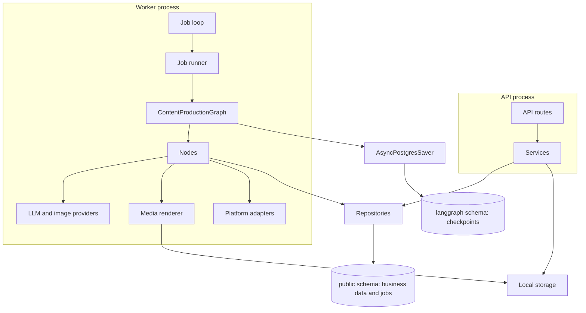

# Architecture

PetMedia AI is a **modular monolith with an independent AI worker**: one Python codebase, split by responsibility, that runs as two processes. There are no microservices, and graph nodes are not deployed separately.

## Layers

| Layer | Folder | Responsibility | Must not |
|---|---|---|---|
| API | `app/api` | Parse requests, call a service, shape responses | Query the database or call AI |
| Services | `app/services` | Business rules, approvals, task lifecycle, exports | Contain HTTP or graph details |
| Repositories | `app/repositories` | All SQLAlchemy queries | Make business decisions |
| AI | `app/ai` | Graph, nodes, prompts, providers, validators | Be imported by the API layer at runtime for generation |
| Media | `app/media` | Storage, upload validation, rendering | Know about tasks or workflows |
| Publishing | `app/publishing` | Platform formats and export files | Run the workflow |
| Workers | `app/workers` | Claim jobs and run the graph | Reimplement workflow logic |

`ApprovalService` does use two pure pieces of `app/ai`: the decision schemas and the validators. Neither touches a provider or the graph.

## How a request flows

1. `POST /tasks` validates the request and, in one transaction, creates the task and a `START_CONTENT_WORKFLOW` job. It returns 202 at once.
2. The worker claims the job, then calls the graph with the task's stable `thread_id`.
3. The graph runs until `interrupt()` pauses it at a review. Its checkpoint is saved in PostgreSQL.
4. The runner reads that checkpoint and sets the task to `AWAITING_*_REVIEW`.
5. A decision request is validated and committed together with a resume job.
6. The worker passes the decision to the graph with `Command(resume=...)`, and the cycle repeats.

The API never touches LangGraph. All they share is PostgreSQL, which is what lets either process restart independently.

## Key decisions and trade-offs

**PostgreSQL job queue, not Redis or Celery.** Claiming uses `FOR UPDATE SKIP LOCKED`, leases recover from crashes, and a job can be committed in the same transaction as the decision that caused it. That atomicity would be lost with a separate broker. The cost is lower peak throughput, which does not matter for one operator.

**Status set after the checkpoint, not by nodes.** `AWAITING_*` statuses are written by the runner, only after the interrupt is durable. If a node wrote them, a decision could arrive before there was anything to resume. Review nodes would also rewrite the status on every re-execution, moving it backwards.

**Decisions commit business effects immediately.** The selected topic or approved version is saved when the API accepts the decision, in the same transaction as the job. Review nodes therefore have no side effects, which suits LangGraph's re-execution of interrupted nodes.

**Frozen generation context.** Product, brand and authorized review facts are copied to `content_tasks.context_snapshot` once. Every step of a task uses the same facts, even if a product is edited midway.

**Async stack with a selector event loop.** psycopg's async mode refuses Windows' default Proactor loop, so entry points go through `app/core/event_loop.py`. This is why the API starts with `python -m app.serve`.

**Direct HTTP for compatible providers, the official SDK for Claude.** `httpx` against OpenAI-style endpoints serves many services without tying the project to one vendor's SDK. Claude's native API is different and its API version has its own rules, so its provider uses Anthropic's SDK, kept to one file.

**Models are chosen per role.** Nodes ask `ModelRouter` for a role and do not know which vendor answers. `ModelRegistry` validates profiles against each provider's capabilities and owns one client per profile. See [model-configuration.md](model-configuration.md).

**One image set for both platforms.** 4:5 portrait suits the Instagram and Facebook feeds, so the carousel is rendered once. `app/media/specs.py` is the place to change this.

## Database and storage

Business tables and LangGraph checkpoints share one PostgreSQL server in separate schemas (`public` and `langgraph`). Checkpoint tables are created and migrated only by the official saver, never by hand. See [database.md](database.md).

Files live under `STORAGE_ROOT`, in `products/`, `brands/`, `generated/` and `exports/`. The database stores relative keys, and every path is checked to stay inside the root. `LocalStorage` implements a small `Storage` protocol, so object storage can replace it later.

## Security in Phase 1

- Credentials come from the environment, are held as `SecretStr` and are never logged.
- Uploads are checked by content rather than declared type, limited in size, and checked for decompression bombs from the header before decoding. Stored names are generated.
- API responses contain URLs, never server paths. Unexpected errors return a generic message; details go to the logs.
- Product data and reviews reach the model as JSON inside `<untrusted_data>`, and the prompts say not to follow instructions found there.
- LLM output is parsed into schemas and never executed.

## Future phases

| Future need | Where it goes |
|---|---|
| New AI vendor | Implement `LLMProvider` and register it in `ModelRegistry` with its capabilities, or implement `ImageProvider` and register it in `app/ai/providers/__init__.py` |
| New platform | Implement `PlatformAdapter`, add a `ModelRole` for it, and register it in `app/publishing/__init__.py`. Channels are plain strings, so no migration is needed |
| Real publishing (Phase 3) | Add a publish method to adapters and a new job type. The graph does not need to know about Meta's API |
| Scheduling (Phase 2) | A scheduler process that calls `TaskService.create_task` |
| Live progress | `task_events` ids already work as a cursor for SSE or WebSockets |
| Object storage | Another `Storage` implementation |
| A frontend | Render from `GET /tasks/{id}`: `status`, `review_stage` and `available_actions` drive the UI |
