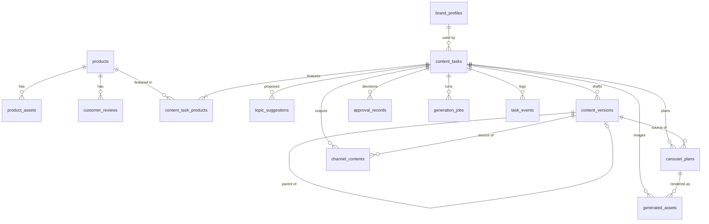

# Database

One PostgreSQL server, two schemas:

| Schema | Holds | Managed by |
|---|---|---|
| `public` | Business data and the job queue | Alembic (`backend/migrations`) |
| `langgraph` | Workflow checkpoints | The official saver's `setup()` (`app/ai/persistence/checkpointer.py`) |

**Business data** is what the product is about: products, drafts, images and decisions. It is kept for as long as the business needs it, and reports and exports read it.

**Checkpoints** are LangGraph's execution state: where a thread is paused and with what values. They hold ids, not content. Nothing in this project reads or writes those tables directly, except a read-only check in tests.

`content_tasks.thread_id` links the two.

## Entity relationships



## Tables

| Table | Purpose | Key constraints |
|---|---|---|
| `products` | Product facts | Unique `sku` |
| `product_assets` | Uploaded photo metadata | |
| `brand_profiles` | Brand voice and rules | Unique `brand_name` |
| `customer_reviews` | Genuine reviews with provenance | `rating` 1 to 5 |
| `content_tasks` | One production request | Unique `thread_id`; `image_count` 3 to 5 |
| `content_task_products` | Task to product links | Composite primary key |
| `topic_suggestions` | Topics grouped by batch | Unique task, batch number, position |
| `content_versions` | Immutable drafts | Unique task and version number; unique task and idempotency key |
| `approval_records` | Every human decision | Unique task and review key |
| `carousel_plans` | Slide plans | Unique task and content version |
| `generated_assets` | Image versions | Unique task, slide, version; unique task, slide, request key; one current image per slide |
| `channel_contents` | Instagram and Facebook output | Unique task, version, platform |
| `generation_jobs` | Durable queue | Unique idempotency key; one active job per task |
| `task_events` | Append-only log | Increasing id, usable as a cursor |

## How integrity is enforced

Most rules are enforced by the database, so they hold even if application code has a bug:

- **One decision per review:** unique `(task_id, review_key)` on `approval_records`.
- **One active job per task:** partial unique index on `generation_jobs (task_id) WHERE status IN ('PENDING', 'RUNNING')`.
- **One current image per slide:** partial unique index on `generated_assets (task_id, slide_number) WHERE status IN ('ACTIVE', 'APPROVED')`.
- **No duplicates from retries:** idempotency keys and uniqueness on versions, assets, channels, plans and topic positions.
- **Optimistic concurrency:** status changes update `WHERE status = :read AND lock_version = :read`. Zero rows updated means someone else got there first.

Enums are stored as `VARCHAR`, so adding a value needs no type migration. Primary keys are UUIDs except `task_events`, which needs ordering. Timestamps are `timestamptz`, set by the database.

## Versioning

**Drafts.** `content` is never updated. Revisions and human edits add a row, linked by `parent_version_id`, with `generation_source` of `AI_INITIAL`, `AI_REVISION` or `HUMAN_EDIT`. Only `approval_status` and `validation`, which describe a draft rather than form part of it, can change. Downstream steps use `content_tasks.approved_content_version_id`, never "the latest".

**Images.** Each regeneration adds a row with the next `asset_version` and marks the previous one `SUPERSEDED`. Old files stay on disk. Exports include only `APPROVED` assets from the approved version.

**Topics.** Each regeneration is a new batch with its own `batch_id`. Earlier batches stay.

**Prompts.** Generated records store a `prompt_version` such as `copy_generation@1`.

## Data lifecycle

1. A task is created with its products and a start job.
2. `load_context` freezes facts into `context_snapshot`.
3. Topics, versions, plans, channels and assets accumulate as the workflow runs. Nothing is overwritten.
4. On `READY`, `completed_at` is set and exports become available. ZIPs are built on first download and cached in `storage/exports`.

**Deletion.** `DELETE /products/{id}` archives the product, because tasks refer to it. Deleting a task row would cascade to its content, but no API does this in Phase 1. Checkpoints and files are not cleaned up automatically; a retention policy is future work, and the saver's `adelete_thread` is the proper way to remove checkpoints.

## Migrations

Create a migration after changing a model, then review the generated file before applying it:

```bash
uv run alembic revision --autogenerate -m "describe the change"
```

```bash
uv run alembic upgrade head
```

The normal schema path is always Alembic, never `create_all()`.
