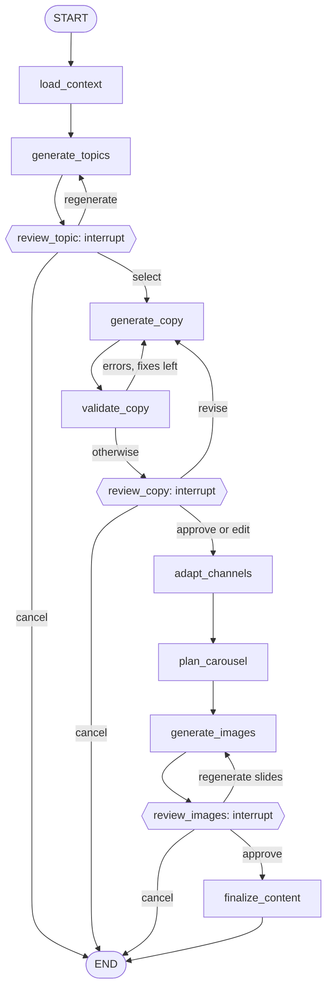
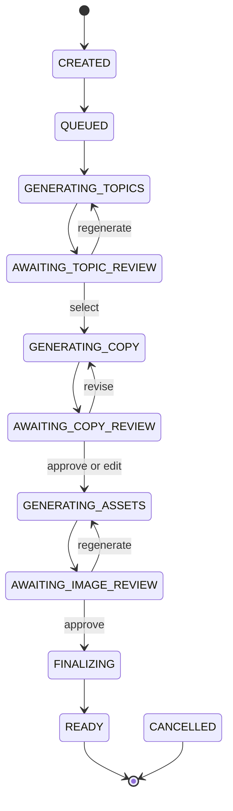

# Workflow

The workflow is one LangGraph `StateGraph`, `ContentProductionGraph`, in `app/ai/graphs/content_graph.py`.

## Nodes

| Node | Does | Idempotency |
|---|---|---|
| `load_context` | Freezes brand, product and authorized review facts on the task | Only writes the snapshot if empty |
| `generate_topics` | Creates a topic batch | Batch number comes from state; an existing batch is reused |
| `review_topic` | Pauses for a decision | No side effects |
| `generate_copy` | Writes a first draft or a new revision | Key: `initial:<topic>`, `revision:<decision>` or `autofix:<version>` |
| `validate_copy` | Stores a validation report; asks for bounded automatic fixes | Report overwrite is harmless |
| `review_copy` | Pauses for a decision | No side effects |
| `adapt_channels` | Creates one record per platform from the approved version | Unique per task, version and platform |
| `plan_carousel` | Creates the slide plan | Unique per task and version |
| `generate_images` | Generates and renders requested slides | Unique per task, slide and request key |
| `review_images` | Pauses for a decision | No side effects |
| `finalize_content` | Links channel content to images, marks READY | Returns early if already READY |

## State

`ContentState` holds only ids and small values such as `selected_topic_id`, `approved_content_version_id` and `pending_slide_numbers`. Content and images stay in the database and storage.

The model router, image provider and database session factory are not state. They arrive through LangGraph's runtime context (`context_schema=WorkflowDeps`), which is not checkpointed, so a restarted worker simply supplies fresh ones.

## Status model

Not shown, to keep it readable: any generating status or `FINALIZING` can move to `FAILED`; `FAILED` can move to `QUEUED` (retry) or `CANCELLED`; `QUEUED` and the three review statuses can move to `CANCELLED`; and `QUEUED` can move to any generating or review status when a retried job picks up. `app/core/status.py` holds the authoritative table. Every change goes through a compare-and-set update in `transition_task`.

## Human review

A review node calls `interrupt(payload, response_schema=...)` once.

- **Pausing:** the payload carries `review_type` and a `review_key` that identifies exactly what is being reviewed: `topic:batch:2`, `copy:<version id>`, or `image:<hash of current asset ids>`.
- **Resuming:** the worker invokes the graph with `Command(resume=decision)` on the same `thread_id`.
- **Bad input:** `response_schema` makes LangGraph validate the decision. Invalid input raises an error and the thread stays interrupted, so no default can ever count as approval.
- **Re-execution:** LangGraph re-runs an interrupted node from the top on resume. These nodes do nothing before `interrupt()` except build a payload from state.

### Decision effects

| Decision | Committed by the API | Graph then |
|---|---|---|
| Topic select | Selected topic, approval record, job | Generates copy |
| Topic regenerate | Approval record, job | New batch, back to review |
| Copy approve | Approved version id, approval record, job | Adapts and plans |
| Copy revise | Version marked `REVISION_REQUESTED`, approval record, job | New version, back to review |
| Copy edit and approve | New `HUMAN_EDIT` version, approved id, approval record, job | Treated as approval of the new version |
| Image regenerate | Approval record, job | Only the chosen slides, back to review |
| Image approve | Assets marked `APPROVED`, approval record, job | Finalizes |
| Any cancel | Status `CANCELLED`, approval record, job | Goes to END |

## Automatic validation fixes

`validate_copy` runs the rules in `app/ai/validators/content_validator.py`. Errors trigger up to `MAX_COPY_AUTO_FIXES` automatic revisions, each stored as a normal version. If errors remain, the draft still reaches the operator with its report in `validation`. If the operator approves anyway, the approval record notes the override. Channel copy and carousel plans get the same bounded correction, with their reports stored alongside them.

## Recovery

PostgreSQL business writes and checkpoint writes cannot share a transaction. So the checkpoint is treated as the source of truth for progress, and `JobRunner` reconciles the business task from it after each run.

`plan_graph_input` looks at the thread before running anything:

| Thread state | Action |
|---|---|
| No checkpoint | Start the graph |
| Interrupted, and the job's `review_key` matches | Resume with the decision |
| Interrupted, and it does not match | Run nothing: the decision was already consumed |
| Checkpoint mid-graph | `ainvoke(None)` continues from the checkpoint |
| Finished | Run nothing |

Here is how that plays out for each crash point:

| Crash happens | On retry |
|---|---|
| Before the decision reaches the graph | Interrupt still pending with the same key, so it is applied |
| During a node | Graph continues from the last checkpoint; the node's saved work is found by its key |
| After the graph paused, before the status update | Nothing runs; reconciliation sets the status |
| After the decision was consumed | Key mismatch, so it is not applied twice |

`durability="sync"` means each step's checkpoint is stored before the next step starts.

## Retry policy

| Level | Applies to | Behavior |
|---|---|---|
| Structured output | Invalid or blank model output | Up to `LLM_MAX_STRUCTURED_RETRIES` calls, or the profile's `max_structured_retries`, with the error sent back to the model |
| Node (`RetryPolicy`) | Timeouts, rate limits, 5xx, database connection errors | Up to `MAX_GENERATION_RETRIES` attempts with exponential backoff |
| Job | Database connection errors reaching the runner; worker crashes | Up to `JOB_MAX_ATTEMPTS` |
| Operator | Any `FAILED` task | `POST /tasks/{id}/retry`, which continues from the checkpoint and carries any unconsumed decision |

Permanent errors such as invalid keys, rejected requests or a model's refusal are not retried, though a [fallback profile](model-configuration.md#fallback-profiles) can answer a refusal. Provider errors do not get job-level retries on top of node retries, which would multiply API calls.

## Preventing concurrent execution

Four independent safeguards keep a thread from running twice:

1. A partial unique index allows one `PENDING` or `RUNNING` job per task.
2. `FOR UPDATE SKIP LOCKED` stops two workers claiming one row.
3. A lease, renewed by a heartbeat, is checked on every worker write. A worker that lost its lease cancels itself.
4. A session-level PostgreSQL advisory lock on the thread is held during execution. If a stalled worker outlives its lease, the new owner finds the lock taken and backs off. If a worker dies, its connection closes and the lock is released automatically.
